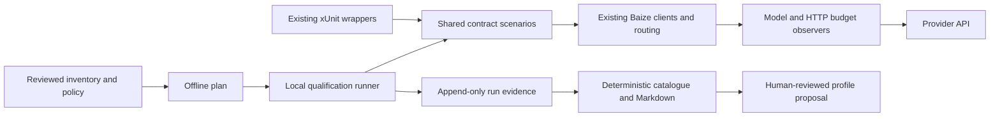

# Model qualification: architecture and implementation roadmap

Status: **Proposed — ready for design review, not approved or implemented.**
Design owner: Astra. Implementation handoff: Sol. Inspected 2026-10-22.

## Repository binding and document map

Repository: `jenolaszlo-sketch/penghou-baize`. Base: `b8f86893851726eb3b40a556435f9202b2460673`
on `main`; design branch: `design/baize-model-qualification`. Worktree:
`Solo/baize-qualification-design`. The source checkout had an existing modification
to `docs/roadmap-experience-signals.md`; it was neither copied nor modified. This
branch starts at committed HEAD. Reconcile its small cross-reference with that
separate edit during integration. No repository AGENTS.md was found.

This document owns architecture, inventory, delivery and handoff. Supporting
specifications avoid repeating the existing compatibility history:

- [Decision record](model-qualification-decisions.md): alternatives and all twelve design questions.
- [Evidence and capability schema](model-qualification-evidence.md): authoritative record semantics and projection.
- [Execution contract](model-qualification-execution.md): CLI, configuration, budgets and recovery.
- [Quirk registry](model-qualification-quirks.md): scope, existing observations and regression discipline.
- [Workflow and graduation](model-qualification-workflow.md): orchestration, CI, promotion and release gates.
- [NVIDIA source review](model-qualification-nvidia.md): official documentation checked during design.

All proposed project names, commands, schemas and schedules below describe future
implementation. This assignment changes documentation only. It creates no schedule,
executes no live API calls, and changes no release or operational routing profile.

## Existing state and reuse inventory

| Inspected surface | Existing implementation or evidence | Reuse and gap |
| --- | --- | --- |
| `README.md`, `Directory.Build.props` | Published line `0.3.0-preview.7`; public API analyzers and deterministic builds | Preserve published contracts; qualification projects are internal, non-packable tooling |
| `tests/Penghou.Baize.IntegrationTests` and its separate solution | net10.0 xUnit v3; `LiveProviderTests`, capability traits, opt-in settings, synthetic media | Extract scenarios incrementally; keep xUnit wrappers and existing trait filters |
| `LiveTestSettings`, `LiveEnvironment` | One environment-selected provider/model; ancestor `.env.local` discovery; credentials checked after loading environment | New runner uses explicit inventory and process-local credential references; no automatic ancestor dotenv loading |
| `LiveClientFactory` | Real routing/DI, provider modules, capability overrides, five-minute default timeout | Reuse composition pattern, not mutable global settings. Current factory explicitly enables raw capture: unsuitable as runner default |
| `LiveProviderTests` | Baseline, tools, sequential and parallel continuation, schema, thinking, four input modalities, native batch | Stable scenario IDs and shared fixtures; no duplicate tests in a second harness |
| Core `LlmEndpointCapabilities`, router `LlmEndpointOptions` | Normalized features, content type/transport, profiles, settings/dialect, endpoint IDs | Embed existing configuration vocabulary; qualification adds provenance and outcomes, not a competing capability model |
| `ConfiguredLlmRouteProvider`, `LlmRouteProviderBase`, `LlmRouter`, `ReliabilityEndpointSelectionPolicy` | Capability filtering precedes ordering; runtime endpoint memory, retries and fallback | Single endpoint per qualification case, retry passes set to one; retain normal validation. Historical runtime memory is not a verified catalogue |
| Core `LlmClientBase`, `LlmStreamAssembler`, `LlmStreamingExtensions` | Common event integrity/collector and completion seam | Inspect semantic and HTTP boundaries; use deterministic malformed-stream fixtures for attribution |
| `Transport/LlmClientBase.ModelTransport.cs` | Base implements `ILlmCompletionClient`, but default completion collects `StreamDirectAsync` | Interface presence is insufficient evidence of a provider-native non-streaming operation; record execution path |
| `Penghou.Baize.Diagnostics` | `LlmStreamParityComparer`, bounded HTTP capture and redaction | Exact parity for identical deterministic fixtures; independent live samples are not byte-equality oracles |
| `Penghou.Baize.Tools` | Canonical schema checks, Nuwa repair provenance, invalid argument status | Distinguish native success, tool-backed schema output and repaired output; inspect unrepaired observations |
| Gemini schema adapter and OpenAI dialect policy/mapper | Existing narrowly placed adaptations and deterministic regressions | Seed registry by references, never replace canonical schemas or add model-name guessing |
| [Live matrix](live-provider-compatibility.md), [append-only log](live-provider-verification-log.md) | Dated 2026-08-12 Gemini/DeepSeek observations and limitations | Preserve verbatim. Import as legacy evidence with missing fields explicit, not new runner verification |
| [Generation matrix](generation-contract-matrix.md) | Implemented vs Probe vs Docs tags across OpenAI/Gemini/Runway/fal.ai | Separate lifecycle qualification from chat evidence and live media purchases |
| [Coverage](coverage.md), `.github/workflows/ci.yml`, `publish.yml` | Package-specific line/branch floors, API checks, transport adoption matrix and separate publishing | Add only offline tooling tests to ordinary CI later; no live gate or publish changes now |

The transport handoff records a historical 2026-10-05 Release build and 871 passes /
14 skips per net8.0/net10.0, plus Tools on net9.0 and package coverage gates. These
are inherited evidence, **not tests rerun by this design assignment**. The installed
SDK inspected here is 10.0.401. No credentials or `.env.local` contents were read.

### Evidence quality issues to preserve and resolve

The baseline prompt requests an exact token, but the assertion uses `Contain`
and does not itself assert a successful finish reason. Single-tool and schema
smokes inspect selected JSON fields, not every canonical constraint. Version new
qualification assertions instead of retrospectively upgrading these results.
The live matrix's Gemini 3.5 Flash parallel row says Pass, while its prose retains
a blocked follow-up observation. The chronological log explains that the full
round trip later passed after paid access was enabled. Preserve both stages and
their changed account conditions in a legacy import; do not erase the earlier
block or infer recovery from table ordering alone. Earlier generation observations predate the
current generation clients; historical “not implemented” text is not current code status.

## Selected architecture

A hybrid keeps the useful xUnit entry point while introducing a small standalone
net10.0 CLI and one non-packable shared scenario library. Both execute the same
scenario functions and assertion results. Neither invokes an LLM judge.

Internal proposed files/projects:

- `tests/Penghou.Baize.Qualification.Contracts/`: scenario definitions, fixtures,
  typed assertion results and contract descriptors. No xUnit runtime or orchestration dependency.
- `eng/Penghou.Baize.Qualification/`: executable, inventory validation, plan,
  scheduler, local budget guard, journal and report commands. Uses existing Baize
  provider packages and `System.Text.Json`; no new public NuGet package, provider
  SDK, database, distributed scheduler or statistical dependency.
- `tests/Penghou.Baize.Qualification.Tests/`: deterministic orchestration, budget,
  evidence and shared-assertion tests using fake model/HTTP transports.
- `eng/qualification/`: reviewed inventory/profile JSON and policy examples;
  `docs/qualification/` later holds schemas, registry and explicitly reviewed
  snapshots. Runtime evidence defaults to ignored `artifacts/qualification/`.

Use internal `ContractDescriptor`, `QualificationContext`, `ContractResult`,
`ResolvedPlan`, `AttemptRecord` and `RunStore` types. A descriptor contains the
versioned ID, capability facet, fixture identities, parameter schema, maximum
dispatches, per-step token caps, applicability and assertion IDs. A scenario
accepts an explicit context and cancellation token, returning structured checks.
It does not resolve credentials, read environment, retry, write files or select models.
The CLI owns these duties. Existing xUnit wrappers translate failed checks to
assertions and preserve capability traits. Extract fixture ownership once; both
entry points reference it. Contracts need no production `src/` changes.

For each case build isolated DI with exactly one model/endpoint and no fallback.
Use the existing router to exercise normal validation, with
`LlmRouterRetryOptions.MaximumAttempts=1`. Wrap `IBaizeModelTransportFactory` to
record each semantic invocation and reserve usage before execution; wrap
`IHttpTransport` to count and restrict every physical request. Observe rather
than alter provider payloads. Preserve host denial and credentials-after-admission.
Execution internals and safety bounds are specified in the execution contract.

## Qualification matrix and levels

“Broad” means inexpensive selection, not a blanket support claim. A planning
exclusion has a reason, owner, evidence reference and expiry; it is not a pass.

| Facet / proposed contract | Existing anchor and independent assertion | Level and claim boundary |
| --- | --- | --- |
| `chat.baseline@2` | `StreamingSmokeTest_ReturnsExpectedContentAndDiagnostics`; exact trimmed `BAIZE_OK`, successful terminal reason, no terminal error | Broad; separately record behavior and termination |
| `chat.streaming-integrity@1` | Same live invocation observed as events; assembly, one valid terminal, no missing-tail warning, tool delta consistency | Broad; a live pass does not replace deterministic chunk-boundary tests |
| `chat.completion@1` / `chat.native-completion@1` | Core completion tests and parity comparer; correct canonical result and actual dispatch path | Deep; default collected stream cannot qualify native completion. No new native implementation in BQ-1 |
| `tools.single@2` | `NativeToolSmokeTest_ReturnsSchemaValidArguments`; one expected call, valid ID, exact name/value and full canonical schema | Broad only where explicitly opted in |
| `tools.sequential@1` | `ComplexToolSmokeTest_CompletesSequentialToolRoundTrip`; lookup, amount 8, result binding and `PLAN-9` | Deep; three calls; preserve Gemini assistant continuation parts |
| `tools.parallel@1` | `ParallelToolSmokeTest_ReturnsTwoCallsInOneTurn`; two distinct IDs, expected arguments, both results and combined answer | Deep; two calls; no inference from single-tool support |
| `structured.native@2`, `structured.tool-backed@2`, `structured.repaired@1` | `StructuredOutputSmokeTest_ReturnsSchemaValidJson`, Tools validation/repair | Broad single selected mode, deep for each additional mode; full canonical validation, original/repaired checks separate |
| `reasoning.control@1` | `ThinkingSmokeTest_ReportsThinkingUsageAndDiagnostics`; explicit mode/effort, observable reasoning or reported thinking usage | Deep; enabled, disabled and effort tiers separate. Hidden reasoning may make observability inconclusive |
| `input.image.inline@1` | `ImageInputSmokeTest_IdentifiesDominantColor`, base64 PNG fixture; RED | Selected broad vision representative; other MIME/transports untested |
| `input.audio.inline@1` | `AudioInputSmokeTest_DetectsAudibleTones`, `WaveAudioFixture`; TONES | Deep; no exact tone-count intelligence benchmark |
| `input.video.inline@1` | `VideoInputSmokeTest_IdentifiesColorSequence`, `AviVideoFixture`; RGB sequence | Deep; distinguish byte acceptance from semantic ordering failure |
| `input.document.inline@1` | `FileInputSmokeTest_ExtractsPdfFields`, `PdfDocumentFixture`; `ORBIT-417 21` | Deep; PDF pass does not imply all document formats |
| `lifecycle.cancellation@1` | Existing core/transport cancellation/disposal tests; new bounded live scenario cancels after first event and observes disposal | Deep opt-in; cannot prove remote compute or billing stopped |
| `errors.classification@1` | Existing provider/core HTTP failure fixtures plus new runner classification tests | Offline mandatory; live only safe, separately authorized negative cases, no deliberate quota exhaustion |
| reliability | Repeat exact selected descriptor with all attempts retained | BQ-4 policy; advisory measurement, no universal intelligence score |
| batch/generation | Existing batch tests and generation shared/provider tests | Separate optional profiles, excluded from initial chat runner |

API acceptance, model compliance, Baize integrity and service availability each
have their own checks. Never attribute a wrong tool to Baize without boundary
evidence. Never classify a correctly formed provider stream corrupted by the
parser as model variability. Preserve “unresolved” until a deterministic fixture
or reviewed protocol trace establishes cause.

## Relationship to governable transport work

The [GM roadmap](governable-model-http-plan.md) remains authoritative. GM-2 is
published chat-first work. BQ-1 uses that supported surface and injected HTTP;
it does not implement or certify GM-3 batch/generation semantic admission,
remaining GM-4 executor/custom-provider closure, or full GM-5 B1–B12 acceptance.
BQ fixtures can supply evidence to those gates but cannot substitute for their
denial, context, handle, dependency and package-consumer checks. Full-surface
graduation waits for their independent closure. No Hufu/Hongxian/Zhinu/Marang
dependency enters Baize or this local runner.

## Ordered delivery and review gates

Every stage requires a separate review of its diff and evidence by the supervising
developer or an explicitly assigned reviewer other than the implementation agent.
Stage completion is recorded against a commit, not inferred from a plan checkbox.
All live execution requires a later explicit authorization and bounded plan.

| Stage | Scope, expected files and exclusions | Dependencies | Acceptance and automated tests | Usage, artifacts and handoff |
| --- | --- | --- | --- | --- |
| BQ-0 | These design documents and links; no implementation | Inspected base and official provider sources | Review decisions, existing test mapping, privacy and budget model; validate docs links/examples | Zero live usage; approved ADR and identified implementation base required before BQ-1 |
| BQ-1a | Shared Contracts project; extract baseline and single-tool scenarios/fixtures; existing integration wrappers | Approved BQ-0 | Fake inputs prove exact token/terminal/tool/schema checks; old trait discovery retained; no global env in shared library; contract version changes reviewed | Zero live usage; descriptor manifest and extraction equivalence report; reviewer approves no assertion weakening |
| BQ-1b | CLI, Qualification.Tests, inventory/plan, bounded local run/resume and minimum evidence envelope | BQ-1a, current GM-2/HTTP seams | Two fake models run; offline plan touches no credential/network; hard request/token/cost ceilings; cancellation, crash points, unknown spend, duplicate writer, redaction and corrupted journal tests | Zero required live usage; fake run bundle, plan and test logs. Local multi-model milestone complete only after safety review; real demonstration remains separately gated |
| BQ-2 | JSON schemas, deterministic projector, catalogue/Markdown and legacy-reference import | BQ-1b | Replay order/duplicate/conflict/staleness/correction tests; unsupported schema major fails; legacy records never silently promoted | No live usage; schema-valid fake/legacy bundles and golden projections; review provenance and no routing mutation |
| BQ-3 | Versioned quirk records, reproduction links and targeted regression backlog | BQ-2 | Match scope positive/negative/ambiguous cases; validate references; migrate existing regressions without duplication | No live usage required; registry diff and reproducibility checklist. Any adapter fix is a separate approved change with fixture evidence |
| BQ-4 | Remaining shared scenarios, predeclared repetitions and drift reports | BQ-1–3 | Mixed/block/retry outcomes, contract-version isolation, revision drift and elapsed-window tests; raw failures survive aggregation | Offline mandatory; optional approved repeated trials consume declared caps. Evidence bundle, comparisons and limitations reviewed before any Verified claim |
| BQ-5 | Local shard import/export and parameterized workflow contract; optional separate manual CI file after funding approval | BQ-2/4 safety demonstrated | Duplicate shard, overlap, stale lease, aggregate budget and partial fan-in tests; CI permission/secrets audit | No scheduled or cloud spending by default. Contract examples and offline rehearsal; reviewer approves future CI activation separately |
| BQ-6 | Representative authorized qualification, evidence reconciliation and release-readiness report | BQ-4 and approved account/budget; full-surface claims also GM-3/4/5 | Run approved frozen matrix and ordinary deterministic/API/dependency gates; verify all advertised claims point to evidence | Live spending only within separately authorized envelope; immutable run hashes, reviewed quirks and graduation report. Human release decision; no automatic publish |

BQ-1 minimum evidence and checkpoint durability are prerequisites, not deferred
to BQ-2. BQ-2 adds projection and formal schema conformance. BQ-1b can produce an
attempt report but cannot mark an operational capability approved.

## First implementation handoff to Sol

After design approval, create a focused BQ-1a change from the then-agreed base.
Read `LiveProviderTests`, `LiveClientFactory`, this plan and the evidence/execution
contracts. Add the non-packable net10.0 Contracts project; move the two existing
baseline/single-tool request fixtures and assertions into explicit-context
scenarios. Preserve the xUnit entry points and filters. Add contract descriptors
`chat.baseline@2`, `chat.streaming-integrity@1`, `tools.single@2`, with dispatch
bound one and output cap 512 each (streaming-integrity observes baseline, does
not dispatch a second call). Record request overrides as new configurations.

Require full schema validation through existing Baize Tools semantics and exact
checks. Test positive and negative response fixtures, malformed arguments, extra
properties, incorrect tool/name/ID, unsuccessful finish and incomplete streaming.
Do not copy the environment loader or raw diagnostics activation into shared
code. xUnit alone may adapt its existing settings to the context. No runner,
production adapter, public API, provider SDK, route policy or live invocation in
this first PR. Include extraction mapping, assertion/version rationale and
deterministic logs. Once reviewed, BQ-1b implements the execution specification
without changing these checks.

## Approval and disposition

Ready for design review. Human approval is required for the hybrid/extraction
boundary, policy defaults (repetitions/freshness/retention), and later endpoint
account limits/terms and spending. These are concrete proposed choices, not
missing architecture that Sol must invent. NVIDIA account entitlements and
bounded economics remain execution preconditions; they do not block offline
BQ-1 implementation. No implementation completion, newly verified model,
GM closure or release readiness is asserted.

## Design validation record

Documentation review checked all seven new specifications, their 21 local links,
both JSON examples and balanced code fences. The README and three roadmap links
point to this proposed design. Git whitespace and scope checks passed for the
11 documentation files; no production source, tests, workflow, compatibility matrix or
verification-history changes are part of this branch. Existing deterministic
tests were not rerun for this documentation-only change; the historical baseline
above remains explicitly attributed. No live tests, credentials, paid calls,
package publication or release-status changes were performed.
